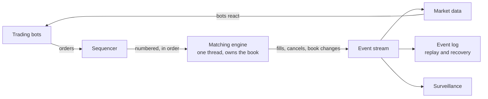

# Order Book Matching Engine

[](https://github.com/poseidonyash/orderbook-matching/actions/workflows/ci.yml)

A small exchange in Python, built to be fast and to catch market manipulation.

| | |
| --- | --- |
| What it is | The matching engine of an exchange, a simulated market of trading bots, and a surveillance module that finds a cheating bot |
| Speed today | 354,153 orders per second, p50 2.40 µs, p99 12.01 µs, on one laptop core in plain Python |
| Status | Phase 1 of 5 is done: the matching engine |
| Language and tools | Python 3.12, uv, pytest, Hypothesis, ruff, mypy (strict) |

## Contents

1. [The idea in one minute](#1-the-idea-in-one-minute)
2. [Quick start](#2-quick-start)
3. [Background: what an order book is](#3-background-what-an-order-book-is)
4. [What the project builds](#4-what-the-project-builds)
5. [How the engine works](#5-how-the-engine-works)
6. [How it is tested](#6-how-it-is-tested)
7. [Results](#7-results)
8. [Roadmap](#8-roadmap)
9. [Repository guide](#9-repository-guide)

## 1. The idea in one minute

An exchange keeps a list of buy orders and a list of sell orders for each thing that it trades. Its matching engine decides which orders trade with each other, and at what price. A real exchange does this hundreds of thousands of times per second, so the engine must be correct and fast.

This project builds that engine and then puts it to work:

1. A matching engine that pairs buy and sell orders with the same rules as real exchanges.
2. A simulated market: trading bots that send orders to the engine. One bot is a spoofer, which cheats.
3. A surveillance module that watches only the public order flow and finds the spoofer.

The target market is a prediction market. There, a contract pays $1 for a YES result and nothing for a NO result, so prices go from 1 to 99 cents.

## 2. Quick start

You need [uv](https://docs.astral.sh/uv/). It also installs Python 3.12 on a machine without it.

Install the environment:

```bash
uv sync
```

Run the tests:

```bash
uv run pytest
```

Run the benchmark on both order books. It takes about 90 seconds:

```bash
uv run python -m bench.run_bench
```

Run the same checks as CI (lint, format, strict types):

```bash
uv run ruff check . && uv run ruff format --check . && uv run mypy
```

## 3. Background: what an order book is

An order book has two sides. Bids are offers to buy, and asks are offers to sell. Each order has a price and a quantity.

| Bids (buyers) | Asks (sellers) |
| --- | --- |
| 10 lots at 50 cents | 10 lots at 52 cents |
| 5 lots at 49 cents | 5 lots at 53 cents |

The highest bid (50) is below the lowest ask (52), so nothing trades. Now a buyer sends an order for 12 lots at up to 53 cents. The engine fills it from the cheapest sellers first:

1. 10 lots trade at 52.
2. 2 lots trade at 53.
3. 3 lots stay in the book as an ask at 53.

This rule is price-time priority. The best price trades first. At the same price, the oldest order trades first. A trade always happens at the price of the order that was already waiting.

## 4. What the project builds

### Matching engine (done)

The engine supports the order types of real exchanges:

| Order type | Behavior |
| --- | --- |
| Limit | Trades up to its price. The rest waits in the book. |
| Market | Trades at any price. The rest is cancelled. |
| IOC (immediate-or-cancel) | Trades up to its price. The rest is cancelled. |
| Post-only | Never trades on arrival. The engine rejects a post-only order that can trade at once. |

It also has self-trade prevention: a trader's order never trades with that same trader's waiting order.

### Simulated market (planned)

Four kinds of trading bots:

| Bot | Behavior |
| --- | --- |
| Noise trader | Buys and sells at random. Some follow the size of the book. |
| Informed trader | Knows the hidden true value and trades toward it. |
| Market maker | Keeps offers on both sides and earns the spread. |
| Spoofer | Places large fake orders to push the price, trades on the other side, then cancels the fake orders. Spoofing is illegal on real markets. |

### Surveillance (planned)

The surveillance module reads only the public stream of orders, cancels and trades: the same view that an exchange compliance team has. It must find the spoofer from that stream. The hard part is the market maker, because it also cancels many orders, but for honest reasons.

## 5. How the engine works



The engine runs on one thread and owns the whole book, so it needs no locks. Every other part only reads the stream of events that the engine writes, so a slow reader cannot slow down matching. Today the matching engine exists. The other boxes come in later phases.

Four design choices make the engine fast:

| Choice | Effect |
| --- | --- |
| Prices are whole numbers of ticks, never floats | Comparisons are exact and quick. |
| One slot for each possible price, indexed by the price | Finding a price level takes one step. |
| At each price, a linked list of orders | A cancel unlinks an order in the same time for 3 orders or 3,000. |
| The book stores its best bid and best ask | Reading them costs nothing. |

## 6. How it is tested

The project has two order books:

- The baseline book uses a simple sorted dictionary. It is slow, but a reader can check it for correctness.
- The fast book is the real engine.

Every rule test runs on both books. Property-based tests with Hypothesis send random sequences of orders and cancels to both books. After every step, they check four rules:

1. The two books give the same results.
2. The best bid is always below the best ask.
3. No quantity appears or disappears.
4. Every trade is at the waiting order's price, inside the incoming order's limit, and between two different traders.

When a test finds a bug, Hypothesis shrinks the failure to the shortest sequence of orders that still fails.

## 7. Results

Both books process the same 1,000,000 messages on one laptop core:

| Engine | Messages per second | p50 latency | p99 latency |
| --- | --- | --- | --- |
| Fast book | 354,153 | 2.40 µs | 12.01 µs |
| Baseline book | 37,752 | 7.80 µs | 217.73 µs |

The p50 is the time that half of the messages beat. The p99 is the time that 99% beat. The fast book meets all three Phase 1 targets: 250,000 messages per second, p50 below 5 µs, and p99 below 20 µs. [BENCHMARKS.md](BENCHMARKS.md) has the method and an explanation of the numbers.

## 8. Roadmap

| Phase | What it adds | Status |
| --- | --- | --- |
| 1. Matching engine | Order book, order types, self-trade prevention, tests, benchmark | Done |
| 2. Event log | Numbered events, replay of any session, recovery after a crash | Next |
| 3. Trading bots | Simulated market with noise traders, an informed trader, a market maker and a spoofer | Planned |
| 4. Surveillance | Spoofing detection, with measured precision and recall | Planned |
| 5. Stretch goals | Network gateway, live dashboard, Rust core, YES/NO contracts | Planned |

## 9. Repository guide

### Where to start reading

| To understand | Read |
| --- | --- |
| The full plan and the reasons behind it | [docs/PLAN.md](docs/PLAN.md) |
| Each feature, its design decisions and its trade-offs | [docs/INTERVIEW_NOTES.md](docs/INTERVIEW_NOTES.md) |
| The fast order book | [src/obm/engine/book.py](src/obm/engine/book.py) |
| The simple baseline book | [bench/baselines/sorted_book.py](bench/baselines/sorted_book.py) |
| The matching rules, as tests | [tests/test_book_behavior.py](tests/test_book_behavior.py) |
| The speed numbers | [BENCHMARKS.md](BENCHMARKS.md) |

### Layout

```
src/obm/engine/   matching engine: types, orders, the fast order book
bench/            baseline book, workload generator, benchmark script
tests/            rule tests, property tests, benchmark smoke tests
docs/             build plan and interview notes
```

The other folders in `src/obm/` hold placeholders for later phases.

### How the work is organized

Each feature is one pull request. The description of each pull request lists its design decisions and the reasons for them. The [closed pull requests](https://github.com/poseidonyash/orderbook-matching/pulls?q=is%3Apr+is%3Aclosed) show the project's history, one feature at a time.
