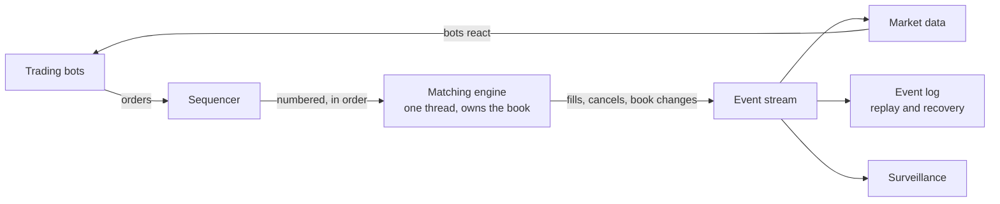

# Order Book Matching Engine

A small stock exchange, written in Python, built to be fast and to catch market manipulation.

The project has three parts:

1. A matching engine: the core of an exchange, which pairs buy orders with sell orders.
2. A simulated market: trading bots that send orders to the engine. One of the bots cheats.
3. A surveillance module: it watches the order flow and finds the bot that cheats.

The current version matches 354,000 orders per second, with a median of 2.4 microseconds per order. That is on one laptop core, in plain Python.

## What an order book is

Every exchange keeps an order book for each thing that it trades. The book is two lists of waiting orders. Bids are offers to buy, and asks are offers to sell. Each order has a price and a quantity.

Here is an example book:

| Bids (buyers) | | Asks (sellers) |
| --- | --- | --- |
| 10 lots at 50 cents | | 10 lots at 52 cents |
| 5 lots at 49 cents | | 5 lots at 53 cents |

The highest bid is 50 and the lowest ask is 52, so nothing trades. Suppose that a buyer sends an order for 12 lots at up to 53 cents. The engine fills it from the cheapest sellers first: 10 lots at 52, then 2 lots at 53. This rule is price-time priority. The best price trades first, and at the same price, the oldest order trades first.

The matching engine applies this rule to every order. A real exchange receives hundreds of thousands of orders per second, so the engine must be both correct and fast.

## What this project builds

The matching engine supports the order types that real exchanges use:

| Order type | Behavior |
| --- | --- |
| Limit | Trades up to its price. The rest waits in the book. |
| Market | Trades at any price. The rest is cancelled. |
| IOC (immediate-or-cancel) | Trades up to its price. The rest is cancelled. |
| Post-only | Never trades on arrival. The engine rejects a post-only order that can trade at once. |

It also has self-trade prevention: a trader's order never trades with that same trader's waiting order.

The simulated market has four kinds of bots. Noise traders buy and sell at random. An informed trader knows the true value and trades toward it. A market maker keeps offers on both sides and earns the spread. A spoofer places large fake orders to push the price, trades on the other side, and then cancels the fake orders. Spoofing is illegal on real markets.

The surveillance module reads only the public stream of orders, cancels and trades. It must find the spoofer from that stream, the same view that an exchange compliance team has. The hard part is the market maker, because it also cancels many orders, but for honest reasons.

The project targets prediction markets. A prediction-market contract pays $1 for a YES result and nothing for a NO result, so its price goes from 1 to 99 cents. The engine itself works for any market with whole-number prices.

## How the engine is built



The engine runs on one thread and owns the whole book, so it needs no locks. Every other part only reads the stream of events that the engine writes. A slow reader therefore cannot slow down matching. Today, the matching engine exists. The other boxes come in later phases.

Four design choices make the engine fast:

- Prices are whole numbers of ticks, never floats. Integer comparison is exact and quick.
- The book has one slot for each possible price, so the price is also the position of its slot. Finding a price level takes one step.
- At each price, the orders form a linked list. Each order points to the orders before and after it. A cancel unlinks the order in the same time for 3 orders or 3,000.
- The book stores its best bid and best ask, so reading them costs nothing.

## How it is tested

The project has two order books. The baseline book uses a simple sorted dictionary, and a reader can check it for correctness. The fast book is the real engine. Every rule test runs on both books.

Property-based tests (Hypothesis) send random sequences of orders and cancels to both books. After every step, the tests check that the books agree and that the book is never crossed. They also check that no quantity appears or disappears. When a test finds a bug, Hypothesis shrinks the failure to the shortest sequence of orders that still fails.

## Results

| Engine | Messages per second | p50 latency | p99 latency |
| --- | --- | --- | --- |
| Fast book | 354,153 | 2.40 µs | 12.01 µs |
| Baseline book | 37,752 | 7.80 µs | 217.73 µs |

Both runs use the same 1,000,000 messages on one laptop core. The p99 latency is the time that 99% of orders beat. The fast book meets all three Phase 1 targets: 250,000 messages per second, p50 below 5 µs, and p99 below 20 µs. [BENCHMARKS.md](BENCHMARKS.md) has the full method and an explanation of the numbers.

## Status

| Phase | What it adds | Status |
| --- | --- | --- |
| 1. Matching engine | Order book, order types, self-trade prevention, tests, benchmark | Done |
| 2. Event log | Numbered events, replay of any session, recovery after a crash | Next |
| 3. Trading bots | Simulated market with noise traders, an informed trader, a market maker and a spoofer | Planned |
| 4. Surveillance | Spoofing detection, with measured precision and recall | Planned |
| 5. Stretch goals | Network gateway, live dashboard, Rust core, YES/NO contracts | Planned |

The full plan is in [docs/PLAN.md](docs/PLAN.md). [docs/INTERVIEW_NOTES.md](docs/INTERVIEW_NOTES.md) explains each feature and the reasons for each design decision.

## Run it

You need [uv](https://docs.astral.sh/uv/). It also installs Python 3.12 on a machine without it.

```bash
uv sync
```

```bash
uv run pytest
```

```bash
uv run python -m bench.run_bench
```

The last command runs the benchmark on both books. It takes about 90 seconds.

For development, use these checks. CI runs all of them on each push:

```bash
uv run ruff check . && uv run ruff format --check . && uv run mypy
```

## Layout

```
src/obm/engine/   matching engine: types, orders, the fast order book
bench/            baseline book, workload generator, benchmark script
tests/            rule tests, property tests, benchmark smoke tests
docs/             build plan and interview notes
```

The other folders in `src/obm/` hold placeholders for later phases.
