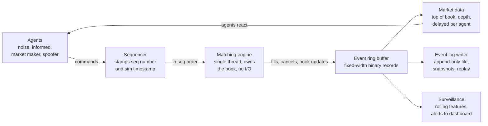
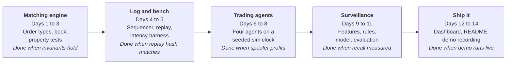

# Order Book Matching Engine: Build Plan

Exported on Nov 3, 2026. The live version is the [build plan doc](https://claude.ai/artifact/ALHXB9gXzC9oM2NncM43pB).

## Goal

You build a small exchange in Python for one instrument. It has three parts. A matching engine pairs buy orders with sell orders. Four kinds of trading bots send orders to it. A surveillance module finds the bot that spoofs. Spoofing is placing large fake orders to move the price, then cancelling them.

This project matches the job description. The engine shows that you can design a fast system. The bots show that you know how traders act. The event log and the surveillance module show that you understand exchange infrastructure.

The project is done when you have these four results:

- A matching engine with published speed numbers and a record of each optimization you made.
- A simulation in which the spoofer moves the price and the surveillance module flags it. You measure how many spoof cycles it catches and how many false alarms it gives.
- An event log that rebuilds the exact same order book each time you replay it.
- A README with an architecture diagram, the speed numbers, and a section about how the design changes at 100 times the load.

## Performance constraints

These targets are for pure CPython on one CPU core. You measure them inside one process, with no network. They are strict enough to force good data structures, but a Python engine can meet them.

Two terms appear in the table. Latency is the time the engine takes to process one message. The p99 latency is the value that 99% of messages beat. O(1) means the cost stays the same as the book grows.

| Constraint | Target | Stretch target | Reason |
| --- | --- | --- | --- |
| Throughput | 250,000 messages per second | 1,000,000 per second with a Rust core | The engine must not be the slowest part |
| Match latency, p50 and p99 | Below 5 µs and below 20 µs | Below 1 µs and below 5 µs | Exchanges judge an engine by its slowest messages |
| Cancel by order ID | O(1) | None | Spoofers and market makers cancel orders all the time |
| Read best bid and best ask | O(1) | None | Every bot reads them on every step |
| Memory for 1,000,000 resting orders | Below 400 MB | Below 150 MB | Small objects use less memory and cache better |
| Determinism | The same event log gives the same book hash | None | Replay, debugging, and audits need it |
| Cost of surveillance | Below 10% loss of throughput | None | Surveillance must never stop the matching |

These design rules follow from the targets:

- Store prices and quantities as integers (ticks and lots). Do not use floating-point numbers in the matching path.
- Use one thread for the engine. That thread owns all of the book state, so the engine needs no locks. Other parts run on other threads.
- Use a sequence number and a simulated clock for time in the engine. Do not use the system clock. This makes replay exact.
- Keep I/O and logging out of the main matching loop. The engine writes events to a ring buffer (a fixed-size queue in memory). A different thread writes them to disk.

## Architecture

One engine thread owns the order book. The sequencer gives each command a number before the engine gets it. Other parts only read the event stream that the engine writes, so a slow reader cannot slow the matching.



In Phase 1, you build only the engine and call it directly. In Phase 2, you add the sequencer, the ring buffer, and the readers. In Phases 3 and 4, the bots and the surveillance module connect to the same stream.

## Phase 1: Core matching engine

In this phase, you build an order book for one instrument and prove that it is correct. The book uses price-time priority. The best price fills first, and at the same price the oldest order fills first.

The engine accepts three commands: `NewOrder`, `Cancel`, and `Modify`. A `Modify` that only reduces the quantity keeps the order's place in the queue. A price change is a cancel and a new order.

The engine supports four order types:

- A limit order rests in the book at its price or a better one.
- A market order fills at the best available prices.
- An IOC (immediate-or-cancel) order fills what it can at once and cancels the remainder.
- The engine rejects a post-only order that can fill at once. It only adds a resting order to the book.

If a trader's new order can fill against that trader's own resting order, the engine cancels the resting order. This rule is self-trade prevention.

The engine sends these events: `Accepted`, `Rejected(reason)`, `Fill(maker_id, taker_id, price, qty)`, `Cancelled`, and `BookUpdate(side, price, new_level_qty)`.

Each part of the book uses the structure in this table:

| Part | Structure | Cost |
| --- | --- | --- |
| Price levels | An array with one slot per tick, for example ticks 1 to 10,000 | O(1) to get a level |
| Orders at one level | A doubly linked list, with the links stored on each order | O(1) to add or remove |
| Find an order | `dict[order_id, Order]` | O(1) to cancel |
| Best bid and best ask | A stored index that moves only when a level becomes empty | O(1) to read |
| Order object | A class with `__slots__` | About one third of the memory of a plain object |

A fixed price range suits prediction markets, because their prices go from 1 to 99 cents. An array is faster than a heap or a sorted dictionary for this range. First, write a simple version with `SortedDict`. Then write the array version and measure the difference. This comparison gives you a good story for the interview.

Write three kinds of tests with pytest and Hypothesis:

- Unit tests for each order type and each edge case. Examples are partial fills, orders that sweep several levels, and the cancel of a partly filled order.
- Property tests on random order streams. The best bid is always below the best ask. Filled, resting, and cancelled quantity always equals the submitted quantity. Each fill uses the price of the resting order.
- A reference test. Write a slow engine that is easy to read and is clearly correct. Send the same random stream to both engines and make sure that their outputs are the same.

## Phase 2: Event log, replay, and benchmarks

In this phase, the event log becomes the source of truth. The order book is only a copy that you can rebuild from the log. Real exchanges use this design for recovery and audits.

Build the event log in four steps:

1. Add a sequencer. It gives each command a sequence number (`seq`) and a simulated timestamp before the engine gets the command.
2. Encode each command and each event as a fixed-size binary record with `struct`. An example is 40 bytes: type, seq, ts, order ID, trader ID, side, price, and quantity. Do not use JSON in the matching path.
3. Write the records to a ring buffer that you allocate at the start. A different thread writes the buffer to an append-only file in batches.
4. Save a snapshot of the book every 100,000 events. A snapshot holds the book state and the last `seq`. To recover, load the snapshot and replay the events after it.

Build replay with these three parts:

- A function `replay(log, until_seq)` that rebuilds the book at any point in time.
- A hash of the book state at the end of each run. A replay of the log must give the same hash. This is your determinism test, and it runs in CI (the tests that run on each push).
- A small command-line tool that steps through a session one event at a time. Later, you use it to show the exact time that the spoofer acted.

Measure speed with these four steps:

1. Write a load generator. It sends a realistic stream to the engine: about 60% new orders, 35% cancels, and 5% orders that fill at once.
2. Record the latency of each message with `time.perf_counter_ns()` into an HDR histogram (a structure that records latency values exactly). Report p50, p99, p99.9, and the maximum. Do not report only the average.
3. Profile the engine with `py-spy` and `cProfile`. Fix the slowest part, then measure again. Record each optimization and its gain in a table in `BENCHMARKS.md`.
4. Turn off the garbage collector during the timed section with `gc.disable()` or `gc.freeze()`. In the README, explain why garbage collection pauses increase the slowest latencies.

## Phase 3: Trading bots

In this phase, you build a simulation with four kinds of bots. Each bot sends commands through the same interface that an outside client uses. No bot changes the book directly.

The simulation works like this:

- A hidden true value V moves as a random walk, with sudden jumps that act as news. Only the informed trader can see V.
- A priority queue of `(wake_time, agent)` drives the clock. A bot wakes, reads the public market data, sends commands, and sets its next wake time.
- Each bot gets market data after a delay that you set. For example, the market maker gets it after 50 µs and the noise traders after 5 ms. You can then test how delay changes the results.
- Each run starts from a seed. The same seed and configuration always give the same run.

Three terms appear in the table. The mid is the price halfway between the best bid and the best ask. Book imbalance is the difference between the visible buy quantity and the visible sell quantity. Inventory is the net position that a bot holds.

| Bot | Behavior | Main parameters |
| --- | --- | --- |
| Noise trader (many) | Sends orders at random times, on a random side, at a random distance from the mid. Cancels orders at random. Some noise traders follow book imbalance, and this makes spoofing profitable. | Arrival rate, price spread, sensitivity to imbalance |
| Informed trader | Buys when the mid is below V by more than a threshold. Sells when the mid is above V by more than the threshold. Sends many small orders that fill at once. | Edge threshold, order size |
| Market maker | Quotes both sides around the mid. Moves its quotes against its inventory, in a simple form of the Avellaneda–Stoikov model. Widens its spread after an informed trader fills against it. Cancels and replaces its quotes on each update. | Target spread, inventory limit, skew factor |
| Spoofer | Places large orders on one side, a few ticks from the best price. Waits for the noise traders to move the price. Then sends a small order on the other side that fills at once. Then cancels the large orders. Repeats at random times. | Spoof size, order lifetime, cycle frequency |

The simulator marks each spoof order with a hidden `is_spoof` label. This label never goes into the event stream. The surveillance module cannot see it, but the evaluation uses it as the ground truth.

Before you start Phase 4, make sure that these three results are true:

- With only noise traders and the market maker, the price stays near V. The market maker earns a small profit.
- When you add the informed trader, the price moves to V faster. The market maker loses money to the informed trader.
- When you add the spoofer, the spoofer earns a profit that you can measure. If it does not, increase the sensitivity of the noise traders to imbalance.

## Phase 4: Surveillance

In this phase, you build a detector that reads the public event log and flags traders who spoof. The event log is the same view that an exchange compliance team has. The detector updates as each event arrives.

The detector has three constraints:

- It reads the event stream as a separate subscriber. It never slows the matching.
- It does a fixed amount of work for each event. It keeps rolling windows for each trader and never scans the full history again.
- It flags a spoof cycle within 1 simulated second after the cancel.

For each trader, the detector calculates these features over rolling windows:

| Feature | What it measures | Value for a spoofer |
| --- | --- | --- |
| Order-to-trade ratio | Orders placed for each order filled | Very high |
| Cancel ratio for large orders | Part of the large orders that the trader cancels | Almost 100% |
| Lifetime of large orders | Time from placement to cancel | Short and regular |
| Side asymmetry | Large orders on one side and fills on the other side | Strongly opposite |
| Distance from the best price | Ticks between the order and the best bid or best ask | Near enough to be seen, too far to fill |
| Sequence pattern | A large order, then a price move, then a fill on the other side, then a cancel | Repeats within seconds |
| Share of the book | Part of the visible quantity on one side that belongs to the trader | Rises quickly, then goes to zero |

Build the detector in this order:

1. Rules. Give a score to each full cycle that matches the sequence pattern. Use limits on lifetime, size, and side asymmetry. Rules are fast and easy to explain, and they can be sufficient.
2. A statistical model. Train a logistic regression or a gradient-boosted tree model on the feature values from many simulated runs. Use the hidden labels as the answers.
3. An LLM case file, as an optional step. For each alert, an LLM writes a short report in plain English. An example: "Trader 17 placed 5 sell orders for a total of 2,000 lots. 300 ms later, the trader bought 40 lots and then cancelled all 5 orders." A compliance analyst can use this report directly.

Two terms appear in the evaluation. Precision is the part of the alerts that are real spoof cycles. Recall is the part of the real spoof cycles that the detector catches.

Evaluate the detector in three ways:

- Measure precision, recall, and detection delay against the hidden labels, over many seeds.
- Study the market maker as a false alarm. It also cancels many orders. Explain how the detector tells it apart from the spoofer: the market maker quotes both sides, uses small sizes, and does not trade against its own quotes. This is the most interesting part of the write-up.
- Make the spoofer harder to see, with smaller sizes, random lifetimes, and split orders. Show how the detection results change.

## Repo layout and tooling

The project is one Python package. Each phase has its own module. The engine module never imports code from the simulation or the surveillance modules.

```
orderbook-matching/
  src/obm/
    engine/        # order.py, book.py, engine.py, types.py
    protocol/      # binary message codecs (struct)
    log/           # sequencer, ring buffer, writer, snapshot, replay
    sim/           # clock.py, runner.py, true_value.py
      agents/      # noise.py, informed.py, market_maker.py, spoofer.py
    surveillance/  # features.py, rules.py, model.py, evaluate.py
    gateway/       # asyncio TCP gateway + WebSocket market data (phase 5)
    dashboard/     # FastAPI + simple frontend (phase 5)
  bench/           # load generator, latency harness
  tests/           # unit, property (Hypothesis), replay determinism
  BENCHMARKS.md
  README.md
```

| Tool | Use |
| --- | --- |
| Python 3.12 and `uv` | Environment and package management |
| `pytest` and `hypothesis` | Unit tests and property tests |
| `hdrhistogram` | Exact latency percentiles |
| `py-spy`, `cProfile`, and `tracemalloc` | CPU and memory profiling |
| `ruff` and `mypy --strict` | Lint and type checks, with strict types on the engine |
| `numpy` and `polars` | Surveillance features and analysis only, never in the engine |
| GitHub Actions | Tests, the determinism test, and a short speed test on each push |
| Docker Compose | The gateway, the engine, and the dashboard as separate services in Phase 5 |

The job asks for an AI-native workflow, so tell the interviewer how you use AI. Use Claude Code to write the reference engine, the property tests, and the repeated setup code. Use your own time for the data structures, the profiling, and the surveillance features. Commit often with clear messages, so that the history shows how you worked.

## Milestones

The plan takes about 14 days of focused work. Start a phase only after the previous phase passes its check.



If the interview comes sooner, stop after Phase 2. You then have the strongest part: an engine that you measured and can replay. The bots and the surveillance module are the second story.

## Interview talking points and stretch goals

Start with a result, not with the list of tools. An example: "My engine matches 300,000 messages per second at 12 µs p99 in pure Python. My detector catches 94% of spoof cycles with 3% false alarms." Use your real numbers.

Prepare answers to these questions:

- Why use one thread? One thread needs no locks, uses the CPU cache well, and gives the same result each run. To scale, give each engine its own set of instruments. Do not add threads to one book.
- Where is Python slow? Each message has interpreter overhead, and garbage collection pauses increase the slowest latencies. Answer with your profiling data.
- How do you scale to 10,000 markets? Split the instruments into shards, with one engine and one sequencer for each shard. Connect the services with a message system such as Kafka or Aeron. Send market data through a separate service.
- How do you recover after a crash? Load the last snapshot and replay the event log after it. Then make sure that the book hash is correct.
- How do you tell a market maker from a spoofer? Use the comparison from Phase 4.
- How does this change for a prediction market? Each contract has a YES side and a NO side, and their prices add up to $1. Prices go from 1 to 99 cents. When the event resolves, every position settles.

Phase 5 adds these stretch goals, in order of value:

1. Add a network layer. Write an asyncio TCP gateway that uses the binary protocol, and send market data over WebSocket. Measure the latency from end to end, not only inside the engine.
2. Add a live dashboard. Show a price chart, a depth ladder (the visible quantity at each price), the profit of each bot, and surveillance alerts as they occur.
3. Write the matching loop in Rust. Rewrite `book.py` in Rust with PyO3 and keep the same Python interface. Record the speed gain in `BENCHMARKS.md`. This covers the "Python, Go, or Rust" item in the job description.
4. Add a binary-contract mode. Use YES and NO books and a resolution event that settles all positions. The project then uses the same terms as the company.
